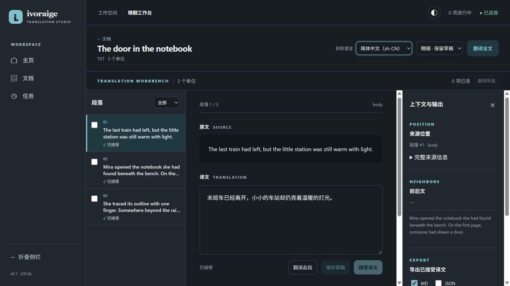

# ivoraige

**供人和 AI 共用、可自由组合的翻译与文件处理基础设施。**

把需要的工具放进同一个工作空间，完成翻译、审校和后续文件处理。

[English](README.md) · **简体中文**

[开始使用](#开始使用) · [当前能力](#当前能力) · [未来方向](#未来方向) · [文档导航](https://github.com/KongouAirlines/ivaraige/blob/main/docs/README.md)

---

ivoraige 将分散的翻译和文档工具组合成可以按需选择的工作流。面向学习者、学生、科研用户，以及为爱发电的翻译者，涵盖学习笔记、论文、小说和日常阅读等场景。

我们希望为人和 AI 提供共同的基础：选用需要的能力，审阅处理结果，让已有工作在不同工具和输出格式之间延续。

*0.1.0 预览版工作台。图中为原创样本与人工录入的译文；当前界面主要使用中文。*

## 组合适合自己的流程

- **按需增加能力。** 从文本和 Markdown 开始，需要处理 PDF 时再安装可选组件。
- **保留人工判断。** 对照原文与译文、保存草稿、接受修订，随时继续已有工作。
- **复用已接受译文。** 从同一冻结快照导出支持的格式，导出不会再次调用模型翻译。
- **选择使用方式。** 当前可使用浏览器工作台或 CLI；面向 AI 客户端的 MCP 入口正在 [PR #18](https://github.com/KongouAirlines/ivaraige/pull/18) 审阅中。

## 开始使用

**Windows 预览版** — 查看 [Releases](https://github.com/KongouAirlines/ivaraige/releases) 和[安装指南](docs/plan/0.1.0/installation-guide.md)。便携包自带运行时，解压后打开 `ivoraige.cmd`。

1. 打开工作台，导入 TXT 或 Markdown 文件。
2. 需要机器翻译时配置模型，也可以直接录入自己的译文。
3. 审校并接受修订，导出结果。

处理 PDF 时，在**设置 → PDF** 安装 BabelDOC，重启程序后按 [PDF 指南](docs/plan/0.1.0/pdf-guide.md)操作。

希望从源码运行？请看[开发指南](https://github.com/KongouAirlines/ivaraige/blob/main/docs/plan/0.1.0/development-guide.md)。详细指南目前以中文为主。

## 当前能力

**早期预览版：`0.1.0-dev.0`。** 功能和界面仍在持续完善。

| 领域 | 已有范围 |
| --- | --- |
| 文本与 Markdown | 导入、翻译任务、人工审校、Markdown/JSON 导出；Markdown 支持范围有单独说明。 |
| PDF · 可选 | 原生文本英文 PDF 到中文单语 PDF，包含来源页码定位与 PDF/Markdown/JSON 冻结导出。 |
| 保存工作 | 持久保存文档、修订、任务和导出快照。 |
| 使用入口 | 本地浏览器工作台与 CLI；MCP 在独立 PR 中，待合入。 |
| 平台 | Windows x64 便携包及 PDF 组件；Node.js 内核通过 Windows、Linux、macOS 测试，不等于三平台 PDF 安装包均已交付。 |

扫描件 OCR、双语 PDF、EPUB、可复用术语库、Zotero 集成和通用文件处理工具仍属未来工作。本地工作台也可以调用在线模型，并不意味着翻译完全离线。详细范围见[能力与限制](docs/plan/0.1.0/capabilities.md)。

## 未来方向

- 更多文档格式和基础文件处理工具，作为可选能力按需取用。
- 持久术语与更丰富的审校流程，适应不同翻译场景。
- Zotero 等工具集成，同时兼顾小说、学习和日常阅读流程。
- Index-Translate 官方 API 的专门支持。
- 以插件形式安装到 DSH，作为较低优先级的探索方向。

这些方向不代表交付日期，范围与跟踪入口见[路线图](https://github.com/KongouAirlines/ivaraige/blob/main/docs/plan/0.1.0/roadmap.md)。

## 了解更多与参与

[工作台使用](docs/plan/0.1.0/workbench-guide.md) · [模型设置](docs/plan/0.1.0/settings-guide.md) · [开发指南](https://github.com/KongouAirlines/ivaraige/blob/main/docs/plan/0.1.0/development-guide.md) · [问题反馈](https://github.com/KongouAirlines/ivaraige/issues)

欢迎告诉我们你想翻译或处理什么、在哪一步遇到困难，以及希望组合哪些工具。可以复现的反馈与原创或可分享的样本尤其有帮助。

基于 Cordis 与 DSH 构建，可选接入 BabelDOC。参见[第三方致谢](THIRD_PARTY.md)。
