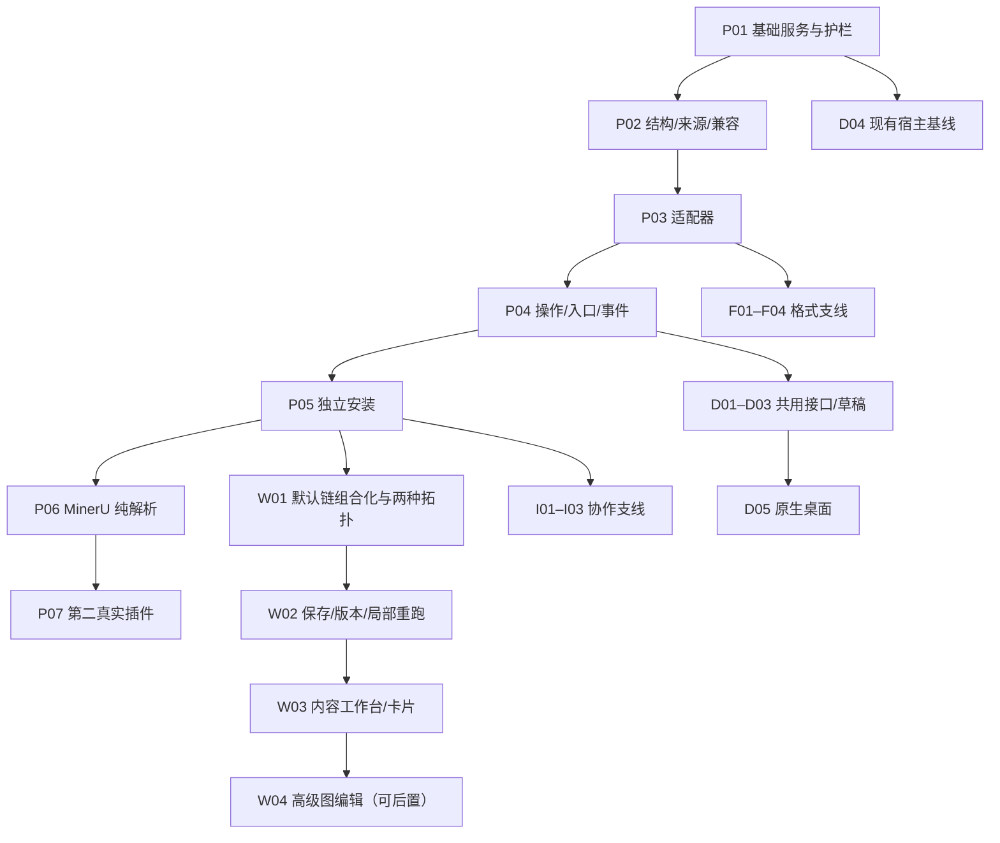

# 0.1.x 首轮组合能力改造规划

本目录是目标软件 **0.1.x** 的活跃规划草案，基于 2026-10-19 核对的 `main` [`43d3f1f`](https://github.com/KongouAirlines/ivoraige/tree/43d3f1fadc4930baa445aeb0cb832b3647aa08d7)。它不表示新契约、插件或桌面功能已经实现，也不是版本发布日期承诺。本轮只建立规划、契约和开发约束，后续按可独立验收的 PR 渐进实施。

## 阅读入口与状态归属

| 文档 | 用途与唯一维护内容 |
| --- | --- |
| [候选版本范围](releases.md) | 0.1.0 基础体系、0.1.1 引擎产品化、0.1.2 桌面；内容分期而非发布承诺 |
| [工作包与依赖](work-packages.md) | PR 切分、范围、不做项、验收、回退；本轮工作包执行状态的唯一表 |
| [工作流与内容工作台](../../requirements/0.1.x/workflows.md) | 可保存组合、定义/实例/执行与来源追溯、内容优先交互；待实施 |
| [格式与软件协作](formats-integrations.md) | DOCX/EPUB/PPTX/XLSX 分级验收，以及有历史依据的客户端候选和通用交接 |
| [目标契约](../../requirements/0.1.x/contracts.md) | 当前实现与目标的差异、服务/生命周期、适配器、入口、事件及兼容草案 |
| [迁移与分发](migration-distribution.md) | 记录、快照、配置和插件包的兼容/恢复验收 |
| [运行时与组件顺序评估](runtime-sequence.md) | Cordis RC、DSH 获取/发行/公共组件边界及候选兼容门禁；不维护执行状态 |
| [验证矩阵](validation.md) | 基础链、第二同类插件、PDF 及桌面验收方法；不作为已通过结果表 |
| [桌面完整方案](desktop.md) | host/托盘/UI/worker 生命周期、故障动作及性能测量协议；指标尚未实测 |
| [统一开发提示词](prompts.md) | 共用任务输入和八类提示词；公共规则只引用 AGENTS/契约 |
| [输入与决策](inputs-decisions.md) | 证据来源、独立输入完整性、待决定项；不复制旧事项状态 |
| [完整审计映射](audit/README.md) | 136 个历史 ID → 75 个审计主题及规划去向；冻结的基线输入，非实时状态表 |

当前交付能力继续以 [0.1.0 能力表](../0.1.0/capabilities.md) 为准，历史测试以 [0.1.0 实施记录](../0.1.0/README.md) 为准。旧事项的状态仍归各 [follow-up](../follow-ups/README.md)，GitHub 讨论仍归原 Issue；工作包只关联旧事项，不把“规划完成”“分支测试通过”写成问题已解决。实际合入、验收证据与未完成范围写回原事项。新增范围外问题先查重后按稳定 ID 登记。

## 首轮交付链

基础契约与护栏 → 适配器改造 → 入口及事件注册 → 独立插件安装 → **没有翻译插件、没有目标语言的 MinerU 纯解析** → **第二同类插件只新增包与配置，主体无需修改**。

整条链跨候选版本推进：0.1.0 的独立安装以 V04a 两个同格式、不同 adapterId 的合规插件验证；0.1.1 的 V05/V06 继续验证真实 MinerU 和第二引擎，不以合成样例替代产品化证据。旧 Records、修订/接受机制、适用性复用、冻结快照均保留。首次补齐通用宿主契约可以调整主体；契约冻结后若第二插件仍要求引擎特判，必须回到契约验收，不能把特判算作插件接入成功。

MinerU 自身的译文 PDF 重建、与 BabelDOC 的质量对照、MinerU → BabelDOC 跨引擎映射分别验收，均不阻塞纯解析交付。桌面生命周期和性能方案并行，正式实现依赖稳定的宿主、操作和事件接口。完整共享项目/多库管理、风格、漫画、超分、完整服务配置管理继续远期；可保存的组合流程另由 W01–W04 明确推进，不再一并归为远期。普通翻译不强制创建项目或打开画布。

## 依赖总图

这是实施依赖图，不是产品只允许一条固定业务流水线。默认处理链在 W01 转为组合定义，并以不同拓扑实测；P06/P07 是独立插件的产品化验证链，不限定所有工作流必须翻译。

图只显示主要依赖，Q01–Q04、P08–P10 及各支线的具体交付门禁仍以[工作包表](work-packages.md)为准。格式与协作、保存编排均不要求等待高级图或原生桌面；格式先 DOCX/可重排 EPUB，协作先公共契约及 Zotero 窄切片，其他候选按证据扩展。

## 版本与替代关系

- 新活跃设计及计划按目标软件 `0.1.x` 组织；[分期范围](releases.md)建议以 [0.1.0 基础候选](../0.1.0/foundation-plan.md)收口最小宿主、Cordis 组合、PDF 分包与共同安全，0.1.1 验证真实引擎，0.1.2 完成桌面体验。版本范围须按实际验收调整；不安排日期或 npm 上架。[npm 就绪准备](../0.1.0/npm-readiness.md)属于基础工程，保留历史同版本记录的时点。
- [v1.0](../../requirements/v1.0/) 的 F-01–F-44、[v2.0](../../requirements/v2.0/01_design_v2.0.md) 的 C1–C8、M5–M8 和历史审查编号保留。这里的工作包编号只用于本轮 PR 切分，不重排旧需求优先级。
- [design-v3](../follow-ups/design-v3.md) 保留原 ID 和历史名称检索关系；它的后续设计入口改为本目录及 0.1.x 契约，不另建 `v3.0` 设计版本。旧文档仅补替代导航，历史报告正文不改写。
- 0.1.x 草案只提出所列边界的替代目标；评审和对应实现合入前，既有协议/行为仍以 0.1.0 与 v2 兼容约定为准。每个实施 PR 必须说明本次启用的契约及兼容路径，不能仅凭此草案宣告全局基线切换。
- 宿主软件版本、插件版本、插件 API、记录/快照 schema、来源绑定版本、sidecar 协议与外部引擎版本分别记录；不因宿主升级而全局改号。当前协议 `API_VERSION = '2.0'` 不随文档改名而自动改变。

## 本轮完成边界

输出可审阅规划和 AGENTS 同步，不改业务源码、不改依赖、不安装或运行真实模型、不启动全面重构。实现阶段必须把代码、定向测试、受影响设计/用户文档放在同一 PR 更新；通过后再更新能力表，不能等所有代码完成后集中补文档。
