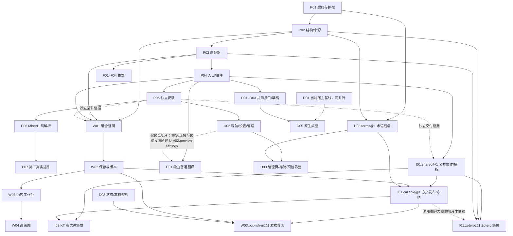

# 0.1.x 首轮组合能力改造规划

本目录组织目标软件系列 `0.1.x` 的增量架构契约、工作包拆分、验证链与专项方案。日常使用与当前已交付能力请从 [0.1.0 能力表](../0.1.0/capabilities.md)开始。

## 阅读入口与状态归属

| 路径 | 入口 | 回答的问题 |
| --- | --- | --- |
| 产品与契约 | [requirements 导航](../../requirements/README.md)：[UI](../../requirements/0.1.x/ui.md)、[工作流](../../requirements/0.1.x/workflows.md)、[组合契约](../../requirements/0.1.x/contracts.md) | 目标体验、领域模型和模块／适配器接口如何定义 |
| 版本范围 | [releases](releases.md) | 各候选版本包含哪些工作包、哪些后置；版本范围仅在此处唯一维护 |
| 执行与验证 | [work-packages](work-packages.md) → 目标包详情 → [验证 ID](validation.md)；[任务提示词](prompts.md) | 当前未完项、前置依赖、已合入实施证据与验收标准 |
| 即时翻译预览 | [预览方案](local-translation-preview.md) | 近期复用已配置模型的调用与保护边界；远期内置引擎候选另见独立研究，不构成当前实现承诺 |
| 来源与专项 | [领域覆盖与重评](domains.md)、[输入决策](inputs-decisions.md)、[专项资料](#专项与历史参考) | 各领域由哪个工作包承接、何时触发重评，以及具体边界的决策依据 |

## 阅读场景

按任务角色按需读取，无需通读整套规划与历史审计文档：

- **新贡献者快速定位**：先看 [0.1.0 当前能力](../0.1.0/capabilities.md)，再从 [requirements 导航](../../requirements/README.md)查阅目标设计，从[执行索引](work-packages.md)查找未完成工作包；历史报告仅在溯源时按需查阅。
- **开发适配器工作包（如 P03）**：读取[本包详情](packages/foundation.md#p03)、[解析／翻译／输出三份独立契约](../../requirements/0.1.x/contracts.md#解析翻译输出三份独立契约)、来源迁移说明和 [V02 验证标准](validation.md#v02)，无需加载无关领域或全量审查记录。
- **开发独立普通翻译页（U01）**：读取[本包详情](packages/ui.md#u01)、[普通翻译设计](../../requirements/0.1.x/ui.md#独立普通文本翻译)和 [U-V01 验证标准](validation.md#u-v01)。独立普通页本身不等待 U02、项目、画布或桌面；仅预览切片另依赖 U02 模型／连接与预览设置交付及 [U-V02.preview-settings](validation/ui.md#u-v02-preview-settings) 验收，转项目接点另接 W02。

## 首轮交付链

`P01 基础契约与护栏` → `P02 结构／来源` → `P03 适配器` → `P04 入口／事件` → `P05 独立安装` → `P06 无翻译的 MinerU 纯解析` → `P07 第二真实同类插件`。基础验证链见 [V01–V06](validation.md#基础验证链)，候选版本分配见 [releases](releases.md)。

## 依赖总图

下图展示实际验收所需的主要依赖关系，完整前置条件以[执行索引唯一表](work-packages.md#执行状态与依赖唯一表)为准。图中虚线表示证据关联或条件适用关系，未标条件的实线表示硬前置。共享契约与客户端适配可并行联调；`I01`／`I02` 编号不代表实现先后，KT 与 Zotero 为同级高优先集成。

## 专项与历史参考

- **架构与跨仓验证**：
  - [四接口 RFC](../../requirements/0.1.x/control-admission-rfc.md)：宿主、入口、插件交付与运行受理的待讨论建议，包含现状差距、并行接线与验收条件。
  - [独立样本库与验证分工](sample-library.md)：`#13` 的跨仓库协作、需授权访问的私有样本库、固定基线命令和证据边界。
- **运行时、迁移与引擎升级**：
  - `P01`/`P05`：[运行时顺序评估](runtime-sequence.md)；`P02`/`P03`/`P05`/`P08`：[迁移与分发矩阵](migration-distribution.md)、[独立插件交付开发说明](plugin-delivery-development.md)。
  - PDF 引擎与闭环：[BabelDOC 0.7.1+ivoraige.3 构建与迁移指南](babeldoc-0.7.1.md)、[PDF 分发闭包审计](pdf-distribution-closure.md)。
- **桌面、格式与外部协作**：
  - `D01`–`D05`：[桌面方案与测量协议](desktop.md)；`F`/`I`：[格式与软件协作路线](formats-integrations.md)；`I01`/`I02`：[共用外部 API 与软件集成](external-api.md)。
- **基础准备与历史审计映射**：
  - [基础优先的缘由](../0.1.0/foundation-plan.md)、[npm 就绪准备](../0.1.0/npm-readiness.md)、[Codex issue 分类与重复初筛](issue-triage.md)。
  - [136 条历史发现 → 75 个主题的来源映射](audit/README.md)、[五份一次性 PR 审查归档](../0.1.0/pr-review/README.md)。

## 版本与替代关系

见[需求与设计导航](../../requirements/README.md)中 `v1.0`／`v2.0` 与 `0.1.x` 的层次关系，以及 [releases 的版本身份说明](releases.md#版本身份)。既有需求 ID、稳定事项 ID 和历史链接保持不变。

## 本轮完成边界

各工作包的实时实施进展及验证证据见[工作包索引](work-packages.md#状态与证据)，当前软件已启用行为以 [0.1.0 能力表](../0.1.0/capabilities.md)为准。
