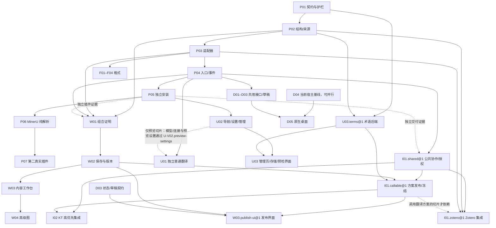

# 0.1.x 首轮组合能力改造规划

按以下路径查阅；当前使用从 [0.1.0 能力表](../0.1.0/capabilities.md)开始。

## 阅读入口与状态归属

| 路径 | 入口 | 回答的问题 |
| --- | --- | --- |
| 产品与契约 | [requirements 导航](../../requirements/README.md)：[UI](../../requirements/0.1.x/ui.md)、[工作流](../../requirements/0.1.x/workflows.md)、[组合契约](../../requirements/0.1.x/contracts.md) | 目标体验、模型和接口如何定义 |
| 版本范围 | [releases](releases.md) | 各候选版本包括什么、哪些后置；版本范围只在此维护 |
| 执行 | [work-packages](work-packages.md) → 目标包详情 → [验证 ID](validation.md)；[任务提示词](prompts.md) | 当前未完项、依赖、实施证据和验收 |
| 即时翻译预览 | [预览方案](local-translation-preview.md) | 近期复用已配置模型的调用与保护边界；远期内置引擎候选另见独立研究，不构成当前实现承诺 |
| 来源与专项 | [领域覆盖与重评](domains.md)、[输入决策](inputs-decisions.md)、[专项资料](#专项与历史参考) | 领域由谁承接、何时重评，某个边界有哪些依据 |

## 阅读场景

- 新贡献者：先看[当前能力](../0.1.0/capabilities.md)，再从 requirements 找目标设计，从执行索引找未完工作；历史报告按需查源。
- P03：读[本包详情](packages/foundation.md#p03)、[适配器契约](../../requirements/0.1.x/contracts.md#解析翻译输出三份独立契约)、来源迁移和 [V02](validation.md#v02)，不必加载其他领域或全量审查。
- U01：读[本包详情](packages/ui.md#u01)、[普通翻译](../../requirements/0.1.x/ui.md#独立普通文本翻译)和 [U-V01](validation.md#u-v01)。独立普通页不等 U02、项目、画布或桌面；仅预览切片另依赖 U02 模型/连接与预览设置交付及 [U-V02.preview-settings](validation/ui.md#u-v02-preview-settings) 验收，转项目接点另接 W02。

## 首轮交付链

基础契约 → 适配器 → 入口/事件 → 独立安装 → 无翻译的 MinerU 纯解析 → 第二真实同类插件。验收见 [V01–V06](validation.md#基础验证链)，版本分配见 releases。

## 依赖总图

图展示实际验收所需的主要关系，完整前置见[执行索引](work-packages.md#执行状态与依赖唯一表)。虚线标注证据关联或条件适用关系，未标条件的实线表示前置。共享契约与客户端适配可以并行联调；I01/I02 编号不表示实现顺序，KT 与 Zotero 为同级高优先集成。

## 专项与历史参考

- P01/P05：[运行时顺序评估](runtime-sequence.md)；P02/P03/P05/P08：[迁移与分发](migration-distribution.md)。
- D01–D05：[桌面方案与测量协议](desktop.md)；F/I：[格式与软件协作](formats-integrations.md)。
- [基础优先的缘由](../0.1.0/foundation-plan.md)、[npm 就绪准备](../0.1.0/npm-readiness.md)。
- [136 条历史发现 → 75 个主题的来源映射](audit/README.md)、[五份一次性 PR 审查归档](../0.1.0/pr-review/README.md)。

## 版本与替代关系

见[设计导航](../../requirements/README.md)的 v1/v2 与 0.1.x 关系，以及 [releases 的版本身份](releases.md#版本身份)。旧 ID 和入口保留。

## 本轮完成边界

实施进展及证据见[工作包索引](work-packages.md#状态与证据)，当前行为见能力表。
