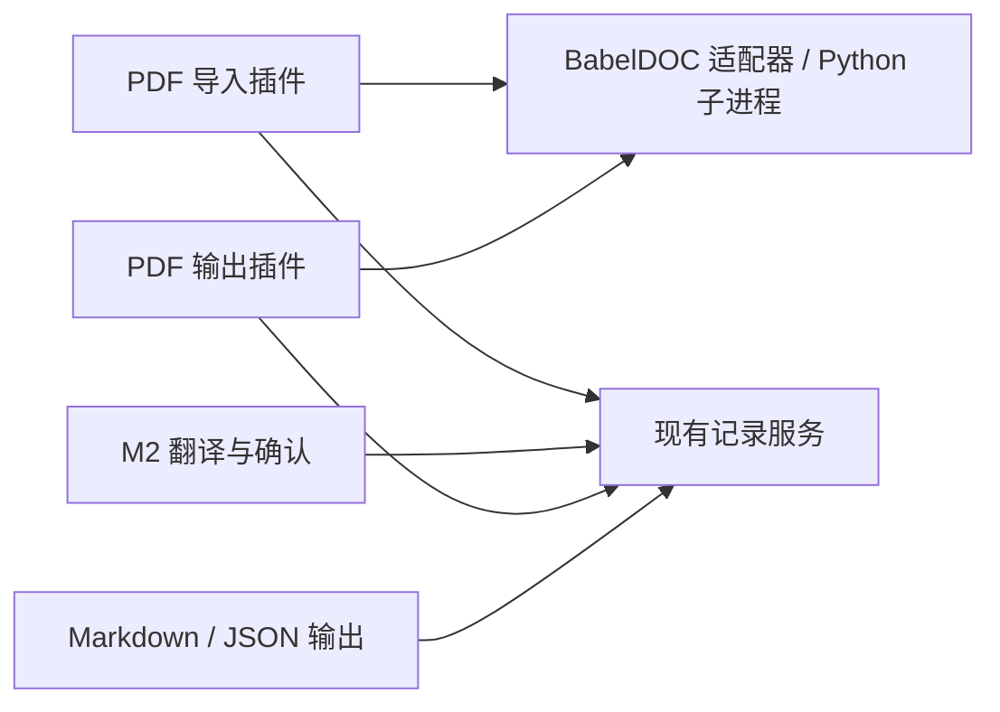

# M3：已有译文回填 PDF 实施与验收规划

后续方向更新（2026-09-30）：下文保留 M3 当时的实施／验收范围。未来阶段以[M0–M3 总结](../retrospective.md)为准，算法处理优先，不默认逐份人工复核或修复上游固有缺陷；样本精修不代替通用适配能力。

日期：2026-09-30｜状态：M3-1～M3-5 工程验收完成，见[固定环境](m3-1-completion.md)、[来源覆盖](m3-2-completion.md)、[同源回填](m3-3-completion.md)、[内容与版面](m3-4-completion.md)及[失败／取消](m3-5-completion.md)。范围为 R03 实际第 1／2／4 页，科研专业签认未完成；未建立 fork 或向上游提交 issue／PR。

依据：[PDF 注入 M1 证据](../m1/pdf-translation-injection.md)、[M2 完成记录](../m2/completion.md)、[M0 范围与验收](../m0/plan.md)。M3 把真实科研 PDF 的可译内容接入现有接受译文记录，再用同一组接受修订生成 PDF、Markdown 和 JSON。**建库过程、库结构与术语适用范围分类仍需另行澄清；本轮只记为后续需求，不修改它们，也不把它们作为 M3 前置。** 既有词库可以使用，未选词库时仍能完成 PDF 翻译。

## 1. 从首次捕获到接受译文回放

以下服务与数据是**本项目拟议契约**，不是已存在的 BabelDOC API；只先补必要字段和操作，不建设通用文档框架。

Cordis 侧先用 PDF 导入和 PDF 输出两个逻辑入口，共用一个引擎适配器即可。导入只产生来源与文本单位；翻译继续调用 M2 的任务／模型服务；输出只读取接受清单，不依赖模型服务。Python 引擎内部的 hook 不暴露给术语、翻译或存储插件。

1. **登记真实 PDF 与限定页范围。** 复用原件登记、已有导入身份／哈希；保留原件。固定 BabelDOC、布局模型、字体与解析配置，使用项目工作目录。首次只选几页，不解析整书。MinerU 既有结果可辅助 source 核查与章节信息；需要额外解析时遵守现有 MinerU 路由，M3 起步不要求全部重跑，也不要求先完成 MinerU↔BabelDOC 自动对齐。
2. **捕获引擎实际 source 请求并核覆盖。** 在不建立正文模型客户端的 capture 路线中记录页码、显式顺序的 bbox 坐标、源段 `source_unicode`、实际 `request_text`、公式／样式占位符和捕获配置；回调返回源文仅用于完成捕获管线，生成PDF为诊断物。核对预期正文、标题、图注和被跳过内容清单；错分公式、短词等不能默认为已处理。若现有管线必须走重建才能拿全请求，MVP 可先承受这一次成本，不预先重写解析流水线。
3. **规范化为持久单位及来源绑定。** 为项目文档／单位分配稳定 ID，把捕获位置和引擎请求作为附件到来源快照，不用随机 debug_id 作业务键。位置对应以同一捕获快照为边界：明确 PDF 页序与坐标原点、bbox 字段顺序与精度，再用实际请求文本完全相等验证。位置碰撞或文本失配集中报告，不能按相似句猜回填。解析器、配置或源 PDF 变化产生新的来源快照并重新核映射，不把旧bbox承诺为跨版本稳定 ID。
4. **仍走独立翻译、词库与接受操作。** 把规范化单位交给 M2 的业务记录／任务；所选术语和正文／可选审校模型由项目配置，建库仍是独立操作。公式和样式占位符作为需要保留的结构，模型与接受修订须能核查；普通可读文本和引擎投影可分字段保存。公式保留／复原属于结构映射，不另做一次模型翻译。人工校正源文或分段后递增来源修订，并更新对应绑定。
5. **冻结同一份接受清单。** 导出前核对源、目标与当前适用约束，缺接受译文、需检查、占位符不完整或覆盖疑点未解决时报告实际缺项。PDF、Markdown、JSON 均引用这份固定单位／revision清单；PDF需的占位符串是该接受修订的确定性投影，人读出口使用可读形式，不能各出口自行生成或改写正文。
6. **回放只消费记录。** 用同版本／配置再次准备 PDF 请求，按来源绑定＋请求文本校验查接受清单；调用BaseTranslator返回已有引擎投影，不加载正文或审校模型。关闭BabelDOC自动术语提取、LLM翻译及其他未选择的自动模型分支，并区分本地布局推理与正文请求。遇到未知／重复／失配回调，即使上游吞异常，适配层汇总也拒绝发布正式结果。
7. **完成检查后发布输出。** 先在临时输出目录重建并核对清单与版面，通过后交付正式PDF／MD／JSON。取消停止后续业务请求，子进程通知与必要终止清理在实施时接入；中断PDF只留诊断或临时结果，不报成功，也不丢已保存接受修订。

M2 当前单位来源仅为段落序号；M3 要增加 PDF 来源快照、版面定位与结构关系，并让出口读固定接受清单。这是本阶段需要的记录扩展，不代表顺便重构术语库。跨页／跨栏段落、1:N 或 N:1 映射若代表页确实需要，再保存明确对应关系；不能为了沿用旧ID把重新分段假作一对一。

## 2. 小样步骤与验收

| 步骤 | 最小可审查产物 | 相称验证 |
|---|---|---|
| M3-1 固定环境与适配边界 | 项目Python启动入口、一个固定BabelDOC组合、封装的capture/replay翻译器与位置hook | 在项目环境跑现有原创控制PDF；确认不改全局安装、重复句位置不同译文、失败不报正式成功；复用M1资产与记录，不重复全库扫描 |
| M3-2 真实代表页捕获与覆盖 | M0已登记实际PDF代表页的块／正文／公式／图注清单，规范化单位及来源绑定 | 首先R03实际第1／2／4页，按页增量处理，覆盖摘要、图1～3、公式(2)～(4)、矢量与单位；必要开发PDF页用于专门符号核查。R03无正式中译参考，源文优先评审；留出答案不进模型／建库 |
| M3-3 接受后同源回填 | 真实单位经独立翻译／检查／显式接受，再冻结一次清单生成PDF／MD／JSON | 出口单位、revision与文字投影一致；关闭模型服务仍能重建和导出；无变更重跑正文与审校新增请求0，记录适配器回调及布局计算单独计数 |
| M3-4 科研内容与版面验收 | 实际输出代表页、源文与译文对照、集中疑点及必要修订 | 每个预期正文／图注有处理或排除原因；公式符号／上下标／编号、图与图注对应、列顺序、页间衔接正确；目视无未解决裁切／覆盖／越界／过小难读；修订只更新接受文字，重排不补翻译 |
| M3-5 变化、失败和取消 | 少量实际映射失败与取消检查、版本适用说明 | 源文或解析配置变化不静默复用；失配、缺记录、坏占位符和引擎吞异常均拒绝正式成功；取消不发新正文请求，旧接受记录保留。只有实际需要升级引擎时，再重跑受影响代表页 |

M1 `We` 漏译必须有具体闭环：在捕获覆盖中显示其未进入翻译器的原因，校正分类／绑定或给出明确需人工处理的缺项；不能把“7/7回调回放成功”当成整页已译。调低min_text_length可能改善短段，但对被判成公式或非译内容的文字不保证有效；根据实际IL与原页证据选择修正，未解决时该页不通过完整覆盖验收。

首次不承诺扫描件、所有表格、所有双栏或任意跨页情形都通过；代表页实际出现的内容必须逐项有结论。自动排版有缩放／重排能力，但原型清晰的两页控制样本不能推导长论文的可读性。真实调用预算沿用当前授权及设置；用户科学签认与代理工程／目视判断分开记录。

M3 完成须至少有一组真实代表页实际通过闭环：来源覆盖无静默漏项，必要科研内容与版面问题已解决，同一接受清单生成三个出口，重导出不重翻，且取消／失配不损害接受记录。其他未通过样本明确列出限制，不以拒绝所有输出代替成功验收。维护方式与固定引擎约束有清晰说明，不能靠自动模型再译掩盖回填缺口。

## 3. 维护方式

当前采用固定 BabelDOC 版本与薄适配层；维护边界、接口证据、升级约束和上游贡献方向见[注入维护方案](injection-maintenance.md)。
