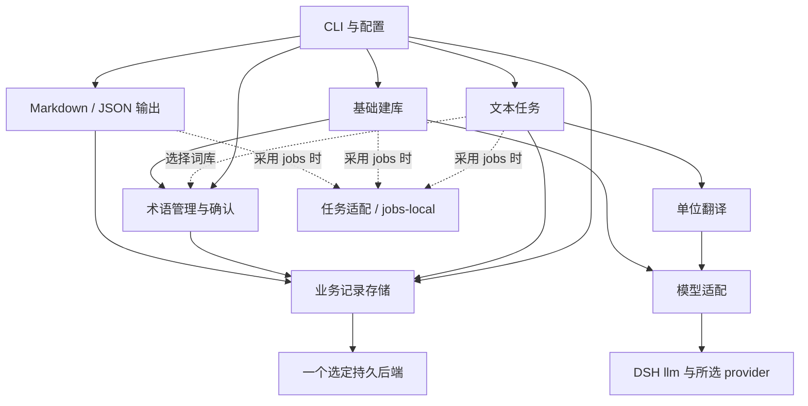

# M2：文本闭环与插件关系规划

日期：2026-09-29｜状态：实施前规划；本文件不代表插件已实现或真实模型验收通过。

依据：[启动计划](mvp-startup.md)、[ADR-0001](../decisions/0001-runtime-selection.md)、[选型 v1.1](../research/tool-selection-v1.1.md)及 [DSH 候选明细](../research/dsh-plugin-candidates.md)。采用已验证的 DSH vendor Cordis 与模型组合，在一个仓库内实现逻辑插件；先不拆 npm 包、不定义完整 SDK，也不先做通用工作流框架。

## 1. 本阶段交付什么

M2 让用户通过最小 CLI 完成科研英译中与学术中译英：输入句段或小文本，选择正文模型、词库与目标，查看草稿，确认或修改译文，保存后导出 Markdown／JSON。再次运行和增加出口时，可复用适用的已接受译文。建库模型与正文模型分别配置；审校可关闭，开启时单独选择模型并记录调用。

| 能力 | M2 最小范围 | 边界 |
|---|---|---|
| 独立双向翻译 | 粘贴／文本文件入口；保留有序单位及来源位置 | 不依赖 PDF 解析或重建 |
| 基础建库与确认 | 从指定少量文本提取候选，保留来源、语境、译名和状态；可确认、修改、合并、导入导出 | 建库是独立操作，可关闭；不自动把模型候选当作已确认知识 |
| 共享／项目词库 | 同时选择，按义项和语境匹配；同一适用义项下项目约定优先 | 冲突原因可查看；歧义不靠全局字符串替换消解 |
| 模型分工 | 建库、正文、可选审校各有显式配置；本地兼容端点与联网开关 | 不要求自动路由、多代理或模型自主规划 |
| 持久译文复用 | 保存源文单位、目标、约束依据、译文修订和接受状态 | 不承诺跨解析器对齐、外部翻译记忆或完整备份迁移 |
| Markdown／JSON | 读取同一组已接受修订，保留单位与修订引用 | 默认缺少适用的接受译文即报告缺项；不在导出时补翻译 |
| 进度／取消 | 单位级状态、失败位置、调用数、可得用量、取消结果 | 进程内运行控制；暂停恢复、持久队列及调度留后续 |

M3 再将解析结果和 PDF 重建接到这些业务记录上。M2 不以现成 Web UI、DSH agent／session 或完整产品壳为前置条件；这些组合仍是需要对应功能时的候选。

## 2. 核心数据流

1. 文本入口创建文档及有序单位，保留语言、来源位置和必要相邻语境。再次运行同一文档使用已有单位，不靠每次重新导入产生的新 ID 找缓存。
2. 用户选择目标、模型分工和词库。术语服务生成本次单位实际使用的已确认义项与约束；未选词库时纯翻译照常进行。
3. 文本任务服务检查该单位的已接受修订与当前约束是否相容。可以复用则返回修订引用；需要重新判断则给出原因；需要翻译且用户已选择该操作时才调用单单位翻译服务。
4. 新结果先作为草稿保存，附来源模型、提示词版本、实际约束、结束原因与用量信息。可选审校产生建议或新草稿，不自行接受、不覆盖人工结果。
5. 用户通过 CLI 直接调用 records 确认或修改并接受一个明确修订；无需加载正文模型。存储成功才报告接受完成。更改源文或约束不会删除历史修订。
6. 出口按一份固定的单位／接受修订清单读取并生成 Markdown／JSON。多出口引用相同修订，导出期间没有模型调用。

建库另走「指定文本 → 建库模型 → 候选术语 → 用户确认 → 共享或项目库」。它通过术语服务提交确认结果，与正文翻译共享模型适配和存储能力，但正文翻译不等待建库。修改候选、确认或接受都是显式业务写入；事件可以刷新进度或界面，不承担决定性的持久化写入。

## 3. 建议的逻辑插件

以下 `ivoraige.*` 是本项目拟定服务名，不是 Cordis 或 DSH 的现成 API。表中必需／可选指业务服务依赖，真实包的注入与传递依赖见候选明细。

| 逻辑插件／提供服务 | 必需依赖 | 可选依赖 | 现成组件与项目责任 |
|---|---|---|---|
| 存储适配／`ivoraige.records` | 选定的一个持久后端 | 无 | 优先试 `dsh-storage`＋`dsh-storage-domain`＋`dsh-storage-json`；项目定义单位、修订、术语等 schema 与显式读写。SQLite medium 可替换 JSON；不能因此声称有关系查询或跨表事务 |
| 术语管理／`ivoraige.terms` | records | 后续外部词典 | 管理义项、候选／确认状态、来源和库修订；组合共享／项目库、报告冲突、给出相关约束。DSH domain 只提供校验与持久 KV，不提供这些语义 |
| 模型适配／`ivoraige.model` | DSH `llm` 与所选 provider | 按所选认证路线需要的 credentials 等 | 复用 `dsh-llm`＋`dsh-llm-pi-ai` 的目录、兼容端点、流与取消。业务边界接收角色配置和取消信号，保留错误及用量是否确知；不重新实现厂商 SDK |
| 单位翻译／`ivoraige.translation` | model | 无 | 接收一个源文单位、目标和已选术语／语境，生成正文及可选审校结果；不查库、不决定复用、不写接受状态 |
| 文本任务／`ivoraige.textTask` | records、translation | terms、所选任务服务 | 协调单位复用判断、上下文准备、草稿写入、进度与取消；接受／人工修订由 CLI 直接调用 records，不成为建库、术语管理和输出的总入口 |
| 基础建库／`ivoraige.termBuilder` | model、terms | 所选任务服务 | 独立提取候选并保留出处；通过 terms 管理候选与确认。关闭此插件不影响已有词库的使用或纯翻译 |
| 文本输出／`ivoraige.textExport` | records | 所选任务服务 | Markdown／JSON 可先为同一插件的两个格式函数；只读适用的接受修订，不依赖 model、translation 或 termBuilder |
| CLI 入口／无长期业务服务 | records；执行某命令时需要对应服务 | terms、termBuilder、textTask、textExport | 做参数／配置解析、展示、调用与取消；组装各插件并预检命令能力，不替代业务规则，不承载中央工作流状态 |

底层任务管理可先用文本任务／建库／导出操作内的运行句柄，不必为几个状态字段增加基础设施插件。如果接入 `dsh-jobs-local` 明显减少工作，再增加一个薄任务适配，使用 jobs 服务的真实 owner/controller 机制；由业务 producer 报告进度并检查取消。`dsh-jobs` 本身是 seam，不能直接加载当实现；local 并发满时拒绝启动，既非队列也非持久任务库。需要 agent owner 才引入真实 agent/session；自有服务任务可按源码契约 attachController。不要为了任务面板先引入 tool-jobs、workflow 或 session 产品壳。

存储先用实际业务小样比较 DSH domain 后端与 Cordiverse database＋SQLite；选择一个实现即可。后者与 DSH vendor Cordis 的身份和 API 还需适配验证，不能仅因同名 Cordis 就混装。DSH JSON 与 SQLite 是后端替代项；同一逻辑 records 服务只注册一个选定实现，避免两个 provider 抢占同一契约。未来换后端先迁移／读回记录，再切换选择。

设置起步为简单配置文件和命令参数。凭据可按需要复用 credentials-local；接受其 home／环境约定并验证本机读写。DSH settings/config-editor 需要 Loader/profile；现成设置页面还需要 remote、slots、session 等客户端能力。允许以后一起采用这些宿主组件，当前不为展示几个选项搭建完整界面。

## 4. 依赖图与装配规则

箭头表示「调用／依赖」，虚线表示选择功能后才需要；CLI 是入口，Cordis 是装配与生命周期载体。

每个服务只声明自己调用的依赖；terms、records、model、textExport 不反向依赖 textTask。单位翻译可以直接接受测试输入，不依赖任务库。Cordis 负责服务发现和插件卸载，业务对象保持普通数据，业务判断尽量采用普通函数；只在适配／入口处接触 `ctx`，不把 DSH Session、Agent 或 Context 存成译文记录。这样允许未来换入口或某个基础设施，而无需先造第二套运行时。

可选依赖的含义是「用户不选择该功能就不需要加载」。用户指定词库而 terms 未加载、开启审校但审校模型不可用、运行建库而 termBuilder 未加载，都必须报告清晰的功能／服务缺失；不能静默忽略词库、关闭步骤或转用远程模型。命令开始前尽可能发现配置错误。选定任务适配未加载时同样报错，不隐式切换运行方式。

## 5. 先约定的最小概念契约

这里只约定输入、结果和责任，具体 TypeScript 签名随第一个业务小样确定。

| 概念 | 最小信息／操作 | 约定 |
|---|---|---|
| 文档与单位 | 文档 ID；稳定单位 ID、顺序、来源位置、源文修订、方向及语境引用 | 初次导入分配 ID；修改源文递增修订。拆分／合并产生新单位并记来源关系，不假装仍是旧单位 |
| 翻译目标 | 目标 ID／修订；语言方向、用途、风格与必要领域约束 | 模型角色配置与目标分开，模型切换不自动取消已接受结果 |
| 译文修订 | 修订 ID；单位／源文修订、目标修订、译文、来源、约束依据、状态 | `draft`、`accepted`、`superseded` 可满足初期需要；接受指向一个明确修订。记录操作者，区分模型草稿与人工修改 |
| 术语 | 库 ID／修订；义项 ID／修订、原词与别名、首选译名／变体、适用语境、来源、候选／确认状态 | 默认仅已确认条目约束正文；共享／项目优先级作用于相容义项，不能把不同义项强行合并 |
| 复用结果 | 可复用的修订引用，或需检查／缺少译文及原因 | 接受状态与当前适用性分开。历史上接受过不等于当前自动适用 |
| 模型调用 | 角色及明确模型配置、文本／约束、AbortSignal；文本、结束原因、错误、可得用量 | 不确定的 usage 为 unknown／空值；不把 SDK 补零当零消耗，不在适配层决定接受或复用 |
| 输出清单 | 固定文档版本、单位及接受修订引用、顺序、目标 | records 提供一致读出的清单；出口先校验缺项再写。需要草稿导出时另设显式选项，并标为草稿，不混入正式接受输出 |
| 运行句柄 | 运行 ID、单位状态、进度、取消操作及最终结果 | 进度表示已处理单位及状态，不把流 token 数当完成量；错误能定位阶段／单位 |

records 不必先暴露通用数据库或全量仓储 SDK。先提供创建／读取文档单位、保存草稿、人工修订／接受、读接受清单及术语读写这些实际操作；CLI 可独立编辑、确认、导出，不经过 textTask 或模型。接受写入需检查调用者看到的当前修订，防止晚到结果覆盖新人工修改；后端落盘失败不更新「接受成功」状态。初期单用户可采用一个明确写入路径，只有遇到具体多记录一致性需求才扩大事务设计。

M1 使用的底层 SDK 可能已把缺失 usage 补成零并丢失来源；薄适配无法事后可靠恢复。首版无法证明由 provider 实际报告的值统一记 unknown；只有在实际接入处保留了存在性证据，才标为已知用量。

双向词库按语言方向选择词形、首选译法与义项；中文词或别名可能对应多个英文表达，中译英不能简单倒转英译中键值表。首版遇到无法确定的方向映射应提示确认，并保留语境判断依据。

### 复用资格与变化处理

同一单位的自动复用至少核对源文修订、语言方向、目标约束、相关语境及本次实际术语依据。保留原文字符串有助核查，但不把字符串相等当全部条件，也不要求每次操作计算内容哈希。导入已有哈希直接复用；ID、修订号和明确引用足以处理多数文本操作。

术语调用记录所选库、库修订、实际约束义项与语境依据。terms 修改通过显式写入先标记使用该库的小文档需检查，再重新选择相关术语并用普通复用判断函数比较实际约束；无关条目变化可更新核对版本并恢复适用，适用义项的译名／含义变化、新增匹配项、库优先级改变则保留需检查及原因。两步间失败仍保持需检查，不把旧结果当现行。不提前建立复杂倒排或依赖图，也不自动重翻。

源文、相关语境、风格目标及词库选择改变时，records 的修改操作同时将受影响单位标为需检查，旧修订仍保留。用户可检查后通过独立接受操作确认沿用，或明确要求重翻；确认沿用记录当前约束下的复核依据，而非改写旧修订来源。仅替换模型／提示词实现默认作为后续生成来源变化，不取消已接受结果。records 冻结输出清单时核对源文／目标／所选库修订与已核对版本，版本不符或需检查就报告缺项；export 读取此清单，不自行术语匹配，也不触发复核或模型调用。

### 取消、在途结果与卸载

用户取消后立即停止派发新单位，向在途请求传递 AbortSignal，并最终展示 cancelled／失败／已完成的单位状态。远端可能已消费请求；晚到或不完整结果不自动接受。完整晚到结果最多保存为标明取消后返回的草稿，写入前仍检查运行取消与源文修订；先前已接受译文保留。模型请求与审校请求分别统计。

插件 dispose 时停止它拥有的运行，撤销监听与临时资源，等待或明确结束必要写入；依赖服务要在使用者完成清理后释放。输出中断不留下看似完整的正式文件，采用临时文件后完成替换即可。进程退出前完成已发起的明确持久写入；不借事件监听偷偷追加接受记录。Cordis dispose、用户取消、进程重启是三个边界；持久译文在重启后可读，不代表未完成任务自动恢复。

## 6. 分步实施与针对性验收

| 步骤 | 可审查产物 | 对应检查 |
|---|---|---|
| M2-1 存储与单位小样 | 最小 schema、选定后端、CLI 文本导入／读取；一份原创小文档 | 源文修改保留稳定 ID 并递增修订；重启读回；保存草稿／人工接受／旧修订；落盘失败不报接受成功。仅验证所选后端 |
| M2-2 纯翻译与模型分工 | DSH 模型适配接正文；英中两个方向；建库／审校配置可预检 | 模拟端点检查目标、显式端点／联网开关、失败与未知用量；关闭 terms 和 termBuilder 仍可完成纯翻译；缺少所选能力时报明确错误 |
| M2-3 接受与输出闭环 | 适用性检查、人工修改、Markdown／JSON 清单输出 | 接受后重跑及双出口正文调用增量为零；两个出口修订 ID 一致；模型服务卸载后仍能人工修改、确认与导出；仅改源文／目标／词库后直接导出也能识别需检查；草稿不误算接受结果 |
| M2-4 术语与独立建库 | 共享／项目组合、候选来源、确认／合并／导入导出、建库模型 | 同义项项目覆盖、不同义项语境区分；建库与正文模型日志可分；关闭建库不影响翻译；候选不会自动成为确认项。无关术语变化可沿用，相关变化能解释需检查且不覆盖人工修订 |
| M2-5 进度与实际小样 | 单位状态与取消；选用 jobs 时补最小接入；开发集真实运行记录 | 模拟取消后无新派发；在途／晚到结果按规则处理；卸载无监听或请求遗留；失败定位单位。之后按允许预算运行 M0 开发集及原创中译英控制文本，记录实际质量问题 |

首轮集中运行受改动影响的检查，不给每个插件分别搭大实验框架。M1 的模型边界已有证据，M2 在真实业务连接与新增行为上补检；已通过且未改变的检查不重复扩张。

真实评估沿用 [M0 范围与验收](m0-scope-and-evaluation.md)：开发集可用于调试；留出参考译文不得进入提示词、建库或复用输入，留出翻译仅在具备评审条件时执行。自动提取与模型评审不能写成人工确认。科学含义、关键术语及原创中译英表达需要用户专业复核，调用数、接受修订和取消行为可以由程序证据验收。

M2 退出条件是上述文本闭环可运行、持久复用与双出口无补翻译、本地端点／联网设置可验证、候选与确认／接受状态清晰，且进度取消通过针对性检查。PDF 同源输出和真实代表页布局仍由 M3 负责。

## 7. 留到实现小样时确定

- 用实际记录读写选定 DSH JSON 或其他一个后端，决定 domain 粒度与接受写入组织；无需同时开发多个 provider。
- CLI 的确认／修订交互形式，以及是否确需 jobs-local；先有可用命令与取消行为，再决定宿主组合收益。
- 真实模型端点、建库／正文／审校角色配置及调用预算；未指定前用模拟端点完成工程检查。
- 首版需检查译文的展示与重新确认方式。它影响复用资格和出口缺项处理，但不要求先做完整精翻工作台。

这些选择不改变上面的插件方向、独立建库或接受译文作为正式输出来源的边界。需要完整 DSH／Koishi 界面或工作流时再更新 ADR 与相应阶段计划。
