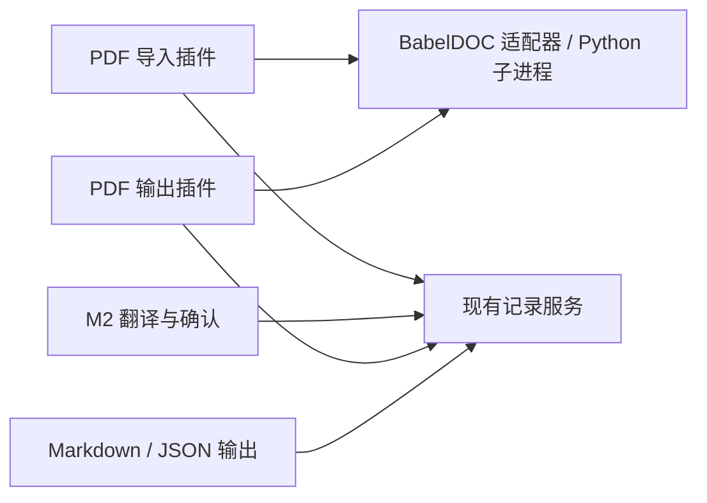

# M3：已有译文回填 PDF 与维护路线规划

日期：2026-09-29｜状态：仅规划；未新增实现、运行实验、建立 fork 或向上游提交 issue／PR。

依据：[PDF 注入 M1 证据](../research/pdf-translation-injection.md)、[M2 完成记录](m2-completion-report.md)、[M0 范围与验收](m0-scope-and-evaluation.md)。M3 把真实科研 PDF 的可译内容接入现有接受译文记录，再用同一组接受修订生成 PDF、Markdown 和 JSON。**建库过程、库结构与术语适用范围分类仍需另行澄清；本轮只记为后续需求，不修改它们，也不把它们作为 M3 前置。** 既有词库可以使用，未选词库时仍能完成 PDF 翻译。

## 1. 建议采用的维护方式

最小 MVP 采用 **官方固定版本 BabelDOC＋项目自有 Python 适配插件**：Cordis 侧负责启动、取消、传递明确输入及接受清单；Python 侧在专用子进程中创建自定义 `BaseTranslator`，并封装当前必要的位置 hook。初期可在本仓库保留一个小型适配目录，不先拆独立发行包。

使用项目选定的 Python 环境与官方依赖，不改用户的 pdf2zh／Zotero 全局安装，不在启动时自动升级或给安装文件打补丁。位置 hook 仅替换该子进程内的方法；进程退出结束它的影响。它依然是对内部实现的适配，不能因此称为零侵入、跨版本稳定或正式插件 API。

| 方式 | 能获得什么 | 成本与边界 | M3 判断 |
|---|---|---|---|
| 自维护“注入版”完整 fork | 能直接修改段落定位、IL 和输出流程；必要时增加接口 | 持续承担上游合并、依赖与安装发布、内部结构变化；可能与用户既有客户端安装冲突 | 不预先建长期 fork。若公开接口及有限 hook 均无法可靠捕获／覆盖／回放，再针对固定提交建立短期、最小改动 fork，并记录退出条件 |
| 插件加载官方固定版本，在专用进程内适配 | 复用正常 BabelDOC 引擎、公开 translator 对象注入；保留小段位置／覆盖适配代码 | 内部 hook 有版本耦合；官方升级需重跑受影响代表页，不能默认兼容；依赖打包仍需单独解决 | **MVP 首选**。维护的是项目适配器和明确支持的引擎版本，用户全局安装不参与 patch |
| 先做上述一种，再贡献公开接口 | 先取得真实数据与缺口证据，再争取上游维护正式入口 | 上游可能不接受或需要改设计，合入时间不可作为交付前提 | 从首选适配路线开始；定位／IL／已有译文接口主要向 BabelDOC 提议；只有需要 pdf2zh-next 的配置或 CLI／GUI入口时，再向其上层提交集成 |

“先选一种，以后贡献上游”是实施顺序，不是现在就 fork 或提 PR 的要求。即使上游暂不接收，固定版本局部适配仍可满足 MVP；若后续合入正式接口，再迁移适配器并移除对应 hook。

## 2. 实际接口所在层次与已知证据

固定证据为 **BabelDOC 0.6.4／`38d3896dcde9b5a940c62cf5563cadea673a64d3`** 和 **PDFMathTranslate-next 2.9.0／`f8dffcf4c3a33b254391d43514439b975ce8d966`**。这是已读源码与 M1 的版本，不是“最新版本”声明，也不是已完成可分发安装包。

| 入口或行为 | 固定源码实际提供 | 对本项目的含义 |
|---|---|---|
| BabelDOC `TranslationConfig(translator=...)` | 接受 `BaseTranslator` 对象、输入 PDF、pages、布局模型、工作目录等 | 可以直接接项目翻译器，先不经过完整 pdf2zh-next 应用；`skip_translation=True` 只是跳过阶段，不是导入已有译文 |
| BabelDOC `BaseTranslator` | `translate`／`llm_translate`，子类 `do_translate`／`do_llm_translate`，占位符方法及缓存 | 公开自定义翻译器路线可消费已有译文；普通回调只有文本与限速信息，无页码／bbox／段落对象 |
| `ILTranslator.translate_paragraph` | 内部接收 paragraph 和 page，经预处理生成真实请求，再后处理译文与 composition | M1 临时包裹此方法把来源放入线程局部上下文；这是内部 hook，不是官方 locator callback |
| BabelDOC high-level pipeline | 自己做解析、布局、ParagraphFinder、StylesAndFormulas，然后翻译与排版 | 它的段落与 MinerU 块不是同一 ID；IL 调试 JSON 可辅助核查，但不等于稳定的“载入修改后 IL 再重建”公开 API |
| pdf2zh-next `create_babeldoc_config` | `get_translator(settings)` 创建翻译器，再交给 BabelDOCConfig 与 BabelDOC async_translate | pdf2zh-next 是引擎选择、配置和客户端的上层封装；本版未发现直接导入 ivoraige 接受译文 JSON 的公开入口 |

证据：[TranslationConfig](https://github.com/funstory-ai/BabelDOC/blob/38d3896dcde9b5a940c62cf5563cadea673a64d3/babeldoc/format/pdf/translation_config.py#L153)、[BaseTranslator](https://github.com/funstory-ai/BabelDOC/blob/38d3896dcde9b5a940c62cf5563cadea673a64d3/babeldoc/translator/translator.py#L79)、[段落内部方法](https://github.com/funstory-ai/BabelDOC/blob/38d3896dcde9b5a940c62cf5563cadea673a64d3/babeldoc/format/pdf/document_il/midend/il_translator.py#L1214)、[解析到翻译阶段](https://github.com/funstory-ai/BabelDOC/blob/38d3896dcde9b5a940c62cf5563cadea673a64d3/babeldoc/format/pdf/high_level.py#L971)、[pdf2zh-next 配置封装](https://github.com/PDFMathTranslate-next/PDFMathTranslate-next/blob/f8dffcf4c3a33b254391d43514439b975ce8d966/pdf2zh_next/high_level.py#L531)。

M1 的 [run.py](../../experiments/pdf-injection/run.py) 用两页原创 PDF 跑了捕获、回放、重复回放：每次回放7次记录回调、0正文／LLM实际请求、0缓存命中，记录内容出现在预期页。公式请求形态为 `E <b1>- m H`，人读输出为 `E = - m H`；重复英文句在不同位置绑定了不同译文。它证明该固定组合的已有译文回填可行，没有证明实际科研页、跨解析器映射或整页输入完整。

M1 还有明确缺口：`paragraph.debug_id` 是随机 base58，重跑不稳定；页码＋三位小数 bbox＋请求原文只在同原件、固定解析版本与配置下工作；`We` 被分离成未进入回调的内容而漏译，说明“回调全匹配”不等于“原文全覆盖”。源码还会跳过过短／不可处理段落，并在某些翻译异常后记录日志继续执行，适配层不能仅以进程退出0或PDF文件存在判断成功。[随机 ID](https://github.com/funstory-ai/BabelDOC/blob/38d3896dcde9b5a940c62cf5563cadea673a64d3/babeldoc/format/pdf/document_il/midend/paragraph_finder.py#L46)、[预处理跳过](https://github.com/funstory-ai/BabelDOC/blob/38d3896dcde9b5a940c62cf5563cadea673a64d3/babeldoc/format/pdf/document_il/midend/il_translator.py#L954)、[异常继续](https://github.com/funstory-ai/BabelDOC/blob/38d3896dcde9b5a940c62cf5563cadea673a64d3/babeldoc/format/pdf/document_il/midend/il_translator.py#L1273)。

M1 通过已有0.6.2依赖环境载入0.6.4源码，属于本机实验做法，不能原样当作产品依赖方案。固定源码中 pdf2zh-next 声明 `babeldoc>=0.6.2,<0.7.0`、`pymupdf<1.25.3`，而 BabelDOC 0.6.4 声明 `pymupdf>=1.26.7`，存在组合冲突。M3 先验证直接 BabelDOC 独立环境，不要求装完整上层；如以后整合 pdf2zh-next，再确认那个组合的依赖兼容。两者源码许可均 AGPL-3.0，实际分发方式与通知随打包方案确认，不把子进程边界等同许可结论。[上层包清单](https://github.com/PDFMathTranslate-next/PDFMathTranslate-next/blob/f8dffcf4c3a33b254391d43514439b975ce8d966/pyproject.toml)、[BabelDOC 包清单](https://github.com/funstory-ai/BabelDOC/blob/38d3896dcde9b5a940c62cf5563cadea673a64d3/pyproject.toml)。

## 3. 从首次捕获到接受译文回放

以下服务与数据是**本项目拟议契约**，不是已存在的 BabelDOC API；只先补必要字段和操作，不建设通用文档框架。

Cordis 侧先用 PDF 导入和 PDF 输出两个逻辑入口，共用一个引擎适配器即可。导入只产生来源与文本单位；翻译继续调用 M2 的任务／模型服务；输出只读取接受清单，不依赖模型服务。Python 引擎内部的 hook 不暴露给术语、翻译或存储插件。

1. **登记真实 PDF 与限定页范围。** 复用原件登记、已有导入身份／哈希；保留原件。固定 BabelDOC、布局模型、字体与解析配置，使用项目工作目录。首次只选几页，不解析整书。MinerU 既有结果可辅助 source 核查与章节信息；需要额外解析时遵守现有 MinerU 路由，M3 起步不要求全部重跑，也不要求先完成 MinerU↔BabelDOC 自动对齐。
2. **捕获引擎实际 source 请求并核覆盖。** 在不建立正文模型客户端的 capture 路线中记录页码、显式顺序的 bbox 坐标、源段 `source_unicode`、实际 `request_text`、公式／样式占位符和捕获配置；回调返回源文仅用于完成捕获管线，生成PDF为诊断物。核对预期正文、标题、图注和被跳过内容清单；错分公式、短词等不能默认为已处理。若现有管线必须走重建才能拿全请求，MVP 可先承受这一次成本，不预先重写解析流水线。
3. **规范化为持久单位及来源绑定。** 为项目文档／单位分配稳定 ID，把捕获位置和引擎请求作为附件到来源快照，不用随机 debug_id 作业务键。位置对应以同一捕获快照为边界：明确 PDF 页序与坐标原点、bbox 字段顺序与精度，再用实际请求文本完全相等验证。位置碰撞或文本失配集中报告，不能按相似句猜回填。解析器、配置或源 PDF 变化产生新的来源快照并重新核映射，不把旧bbox承诺为跨版本稳定 ID。
4. **仍走独立翻译、词库与接受操作。** 把规范化单位交给 M2 的业务记录／任务；所选术语和正文／可选审校模型由项目配置，建库仍是独立操作。公式和样式占位符作为需要保留的结构，模型与接受修订须能核查；普通可读文本和引擎投影可分字段保存。公式保留／复原属于结构映射，不另做一次模型翻译。人工校正源文或分段后递增来源修订，并更新对应绑定。
5. **冻结同一份接受清单。** 导出前核对源、目标与当前适用约束，缺接受译文、需检查、占位符不完整或覆盖疑点未解决时报告实际缺项。PDF、Markdown、JSON 均引用这份固定单位／revision清单；PDF需的占位符串是该接受修订的确定性投影，人读出口使用可读形式，不能各出口自行生成或改写正文。
6. **回放只消费记录。** 用同版本／配置再次准备 PDF 请求，按来源绑定＋请求文本校验查接受清单；调用BaseTranslator返回已有引擎投影，不加载正文或审校模型。关闭BabelDOC自动术语提取、LLM翻译及其他未选择的自动模型分支，并区分本地布局推理与正文请求。遇到未知／重复／失配回调，即使上游吞异常，适配层汇总也拒绝发布正式结果。
7. **完成检查后发布输出。** 先在临时输出目录重建并核对清单与版面，通过后交付正式PDF／MD／JSON。取消停止后续业务请求，子进程通知与必要终止清理在实施时接入；中断PDF只留诊断或临时结果，不报成功，也不丢已保存接受修订。

M2 当前单位来源仅为段落序号；M3 要增加 PDF 来源快照、版面定位与结构关系，并让出口读固定接受清单。这是本阶段需要的记录扩展，不代表顺便重构术语库。跨页／跨栏段落、1:N 或 N:1 映射若代表页确实需要，再保存明确对应关系；不能为了沿用旧ID把重新分段假作一对一。

## 4. 小样步骤与验收

| 步骤 | 最小可审查产物 | 相称验证 |
|---|---|---|
| M3-1 固定环境与适配边界 | 项目Python启动入口、一个固定BabelDOC组合、封装的capture/replay翻译器与位置hook | 在项目环境跑现有原创控制PDF；确认不改全局安装、重复句位置不同译文、失败不报正式成功；复用M1资产与记录，不重复全库扫描 |
| M3-2 真实代表页捕获与覆盖 | M0已登记实际PDF代表页的块／正文／公式／图注清单，规范化单位及来源绑定 | 首先R03实际第1／2／4页，按页增量处理，覆盖摘要、图1～3、公式(2)～(4)、矢量与单位；必要开发PDF页用于专门符号核查。R03无正式中译参考，源文优先评审；留出答案不进模型／建库 |
| M3-3 接受后同源回填 | 真实单位经独立翻译／检查／显式接受，再冻结一次清单生成PDF／MD／JSON | 出口单位、revision与文字投影一致；关闭模型服务仍能重建和导出；无变更重跑正文与审校新增请求0，记录适配器回调及布局计算单独计数 |
| M3-4 科研内容与版面验收 | 实际输出代表页、源文与译文对照、集中疑点及必要修订 | 每个预期正文／图注有处理或排除原因；公式符号／上下标／编号、图与图注对应、列顺序、页间衔接正确；目视无未解决裁切／覆盖／越界／过小难读；修订只更新接受文字，重排不补翻译 |
| M3-5 变化、失败和取消 | 少量实际映射失败与取消检查、版本适用说明 | 源文或解析配置变化不静默复用；失配、缺记录、坏占位符和引擎吞异常均拒绝正式成功；取消不发新正文请求，旧接受记录保留。只有实际需要升级引擎时，再重跑受影响代表页 |

M1 `We` 漏译必须有具体闭环：在捕获覆盖中显示其未进入翻译器的原因，校正分类／绑定或给出明确需人工处理的缺项；不能把“7/7回调回放成功”当成整页已译。调低min_text_length可能改善短段，但对被判成公式或非译内容的文字不保证有效；根据实际IL与原页证据选择修正，未解决时该页不通过完整覆盖验收。

首次不承诺扫描件、所有表格、所有双栏或任意跨页情形都通过；代表页实际出现的内容必须逐项有结论。自动排版有缩放／重排能力，但原型清晰的两页控制样本不能推导长论文的可读性。真实调用预算沿用当前授权及设置；用户科学签认与代理工程／目视判断分开记录。

M3 完成须至少有一组真实代表页实际通过闭环：来源覆盖无静默漏项，必要科研内容与版面问题已解决，同一接受清单生成三个出口，重导出不重翻，且取消／失配不损害接受记录。其他未通过样本明确列出限制，不以拒绝所有输出代替成功验收。维护方式与固定引擎约束有清晰说明，不能靠自动模型再译掩盖回填缺口。

## 5. 将来向上游贡献什么

目前最明确缺口是公开翻译器回调缺少定位信息，以及没有本项目已验证的稳定“外部接受译文／IL输入后重建”接口。**以下只是拟议方向，不是声称上游已有功能：**

- 向 BabelDOC 提议可选来源上下文／locator callback，让适配器得到页、来源块与必要结构，且说明ID在哪些源／版本边界内稳定；不是要求上游承诺任意改版永久ID。
- 或提议公开的IL导出／校验／导入或已有译文映射入口，能让外部系统先核覆盖、接受与绑定，再确定性重建；明确缺项与占位符错误应对外报告失败。
- 若后续用户需要保留 pdf2zh-next 的CLI／GUI，向其贡献选择外部译文提供方、清单路径或入口传递；定位和排版结构接口仍主要由BabelDOC解决。

先由M3代表页证明哪个接口最小、确实能减少内部hook，再决定提案。需要短期fork的条件是：普通公开注入和限于专用进程的局部适配无法可靠完成必要覆盖／结构回填，或内部异常处理无法被外层汇总可靠观察；届时只维护必要改动与固定基线，同时保留上游贡献／退出路线。本轮不提前建立fork、不修改官方源码，也不预先提交提案。
